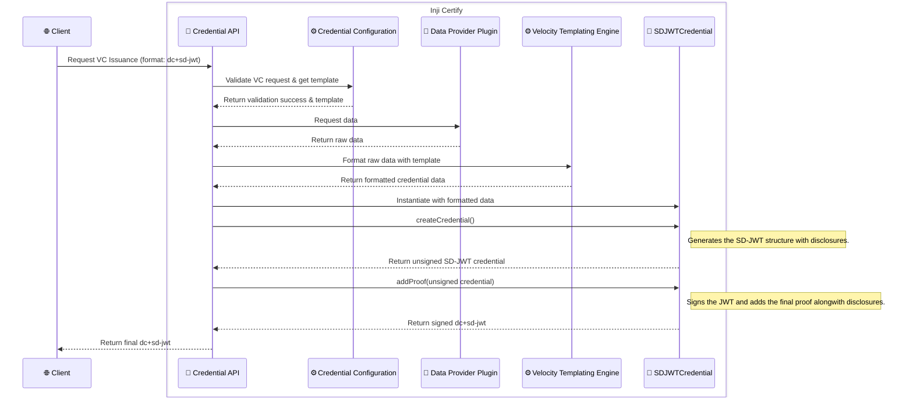

# SD-JWT Credential Support

This document explains how to configure and use SD-JWT (Selective Disclosure JWT) credential format in the Inji Certify service.

---

## 1. How to Configure SD-JWT Credentials

To add a new SD-JWT credential configuration, use the `/credential-configurations` endpoint with the following important fields in your JSON payload:

- **credentialFormat**: Must be set to `dc+sd-jwt`
- **signatureAlgo**: The signing algorithm (e.g., `ES256K`). It is mandatory in DataProvider plugin mode and optional in VCIssuance plugin mode, where the plugin signs the credential. A value that is sent is validated in both modes against `mosip.certify.signature-algo.key-alias-mapper`: the deployment must hold a signing key for it, or the request is rejected with `key_chooser_config_not_found`. It is also the value the credential issuer metadata advertises in `credential_signing_alg_values_supported`.
- **sdJwtVct**: The VCT (Verifiable Credential Type) value for the credential
- **cryptographicBindingMethodsSupported**: The binding methods to advertise, chosen from those declared for `dc+sd-jwt` in `mosip.certify.credential-config.cryptographic-binding-methods-supported` (e.g., `["jwk"]`)
- **proofTypesSupported**: The proof types to accept, each with its proof signing algorithms, chosen from `mosip.certify.credential-config.proof-types-supported` (e.g., `{"jwt": {"proof_signing_alg_values_supported": ["ES256"]}}`)

`cryptographicBindingMethodsSupported` and `proofTypesSupported` are mandatory, and so is `signatureAlgo` in DataProvider plugin mode; nothing is filled in from the properties when one is missing or empty. A `dc+sd-jwt` configuration without `signatureAlgo` (VCIssuance plugin mode) leaves `credential_signing_alg_values_supported` out of the credential issuer metadata. `signatureCryptoSuite` must not be sent for `dc+sd-jwt`. The request no longer takes a `credentialSigningAlgValuesSupported` list; a request that still sends it is rejected with `invalid_request`.

For full details on the required fields and how to structure your request with examples, refer to the [Inji Certify API documentation](https://mosip.stoplight.io/docs/inji-certify).

---

## 2. Specific Configurations Required

Add the following properties to your `application.yml` or `application.properties` to enable and control SD-JWT support:

| Property Name                                                          | Description                                                                                                                                                               | Example Value                                      |
|------------------------------------------------------------------------|---------------------------------------------------------------------------------------------------------------------------------------------------------------------------|----------------------------------------------------|
| `mosip.certify.signature-algo.key-alias-mapper`                       | Maps each signing algorithm to its key aliases. An SD-JWT configuration's `signatureAlgo` must be one of its keys.                                                        | `{'ES256': {{'CERTIFY_VC_SIGN_EC_R1', 'EC_SECP256R1_SIGN'}}}`              |
| `mosip.certify.credential-config.proof-types-supported`                | Supported proof types for SD-JWT                                                                                                                                          | `{'jwt': {'proof_signing_alg_values_supported': {'RS256', 'PS256', 'ES256', 'EdDSA'}}}`                     |
| `mosip.certify.credential-config.cryptographic-binding-methods-supported` | Supported binding methods for SD-JWT                                                                                                                                      | `{ 'ldp_vc': {'did:jwk','did:key'}, 'mso_mdoc': {'cose_key'},'dc+sd-jwt': {'jwk'} }`          |
| `mosip.certify.data-provider-plugin.did-url` | The base Decentralized Identifier document URL used by the data provider plugin to resolve and bind DIDs for credential issuance.                                         | `did:web:someuser.github.io:somerepo:somedirectory` |
|`mosip.kernel.keymanager.signature.kid.prepend`| The prefix to prepend to the `kid` field in SD-JWT credentials. This is useful for ensuring unique key identifiers across different systems. Default value will be blank. | `#`, `<DOMAIN_NAME>#` or `PAYLOAD_ISSUER`                          |
---

## 3. Sequence Diagram for SD-JWT Credential Issuance

## 4. Configuring `kid` and DID Binding

### `kid` (Key ID)
- The `kid` field identifies the keyID of the certificate that is used for signing the VC.
- You can configure the `kid` prefix using the property `mosip.kernel.keymanager.signature.kid.prepend` to ensure uniqueness across different credentials.
  - if you set it to `#`, the `kid` will be prefixed with `#`. example: `#<KEY_ID>`
  - if you set it to `<DOMAIN_NAME>#`, the `kid` will be prefixed with the domain name followed by `#`. example: `example.com#<KEY_ID>`
  - if you set it to `PAYLOAD_ISSUER`, the `kid` will be prefixed with the issuer of the payload. example: `did:example:123#<KEY_ID>`

### Holder Key Binding
- Key binding ensures the credential is cryptographically linked to the key the holder proved possession of in the credential request.
- The holder key is read from the JWT proof header, given as a `jwk`, or as a `did:jwk` or `did:key` `kid`.
- In the final SD-JWT credential, the `cnf` claim carries that key as a JWK ([RFC 7800 §3.2](https://www.rfc-editor.org/rfc/rfc7800.html#section-3.2)), holding only its public key members:
  `{ ... "cnf": { "jwk": { "kty": "EC", "crv": "P-256", "x": "...", "y": "..." } } ... }`
- Whatever form the proof gave the key in, `cnf` always carries it as a JWK. `cryptographicBindingMethodsSupported` describes how the key appears in the issued credential ([OID4VCI 1.0 §12.2.4](https://openid.net/specs/openid-4-verifiable-credential-issuance-1_0-final.html#section-12.2.4)), not which proofs are accepted, so a `dc+sd-jwt` configuration advertises `["jwk"]`. Proofs carrying a `jwk`, `did:jwk` or `did:key` are all still accepted.

---

## Notes

- Ensure your signing keys, DIDs are properly registered and accessible to the Certify service.
- For more details on the API, see the [Inji Certify API docs](https://mosip.stoplight.io/docs/inji-certify).

---